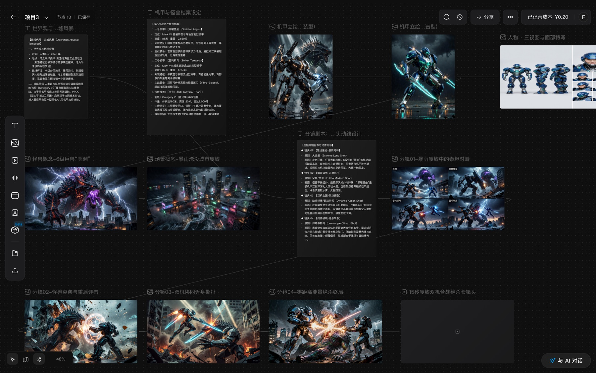
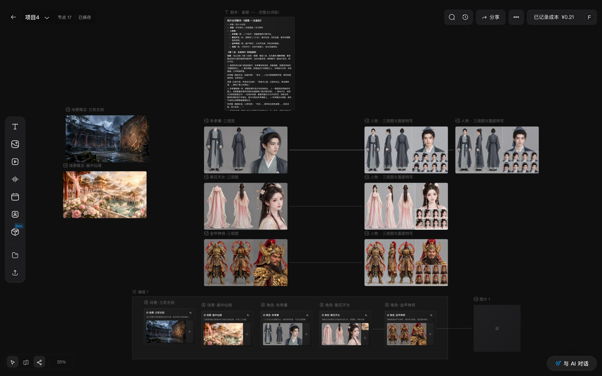
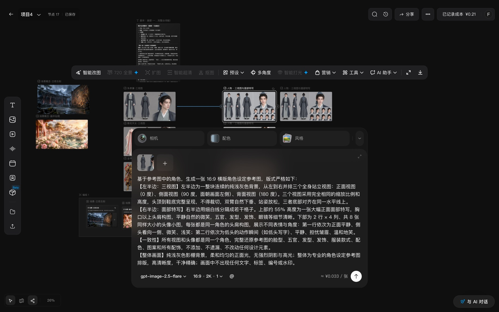
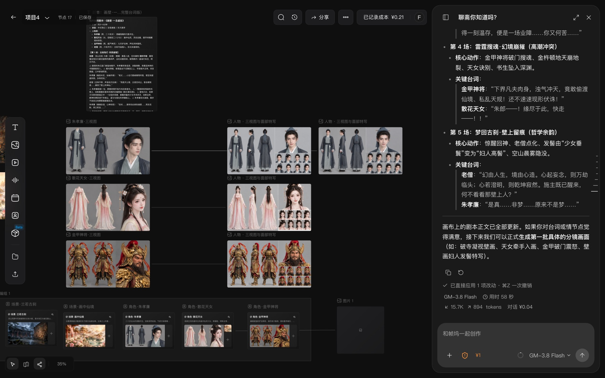
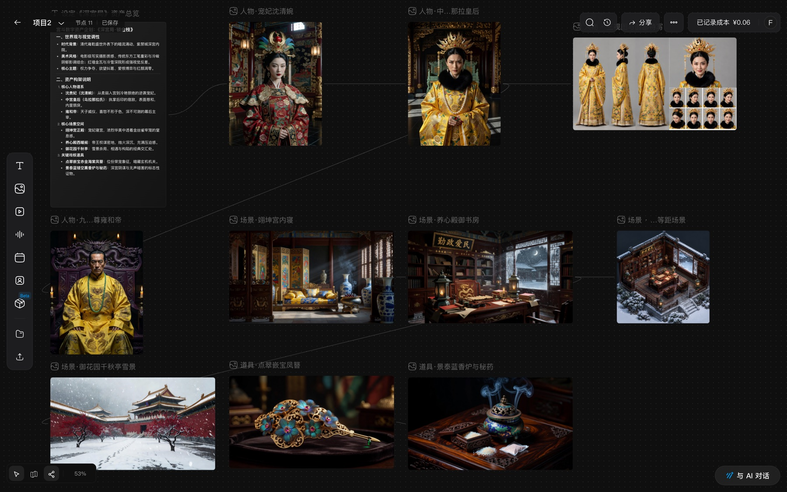
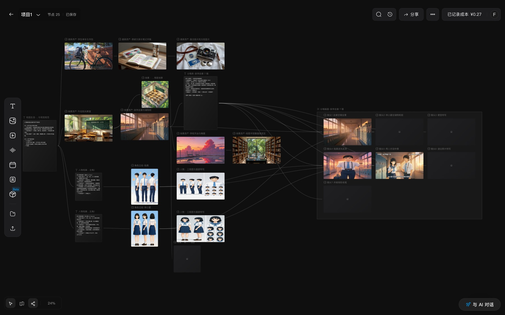
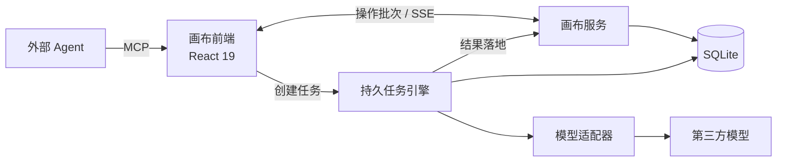

<div align="center">


# FrameDock · 帧坞

**AI 短片创作的无限画布：剧本、角色、分镜、出图、出视频，在一张画布上完成**


</div>



<p align="center"><sub>一张画布上的完整链路：世界观 → 机甲与怪兽设定 → 分镜脚本 → 分镜图 → 视频</sub></p>

## 解决什么问题

| 痛点 | FrameDock 的做法 |
|---|---|
| 剧本、出图、出视频分散在多个网站，素材靠下载上传搬运，流程留不下来 | 一张无限画布串起全流程，连线即数据依赖，链路可复用 |
| 多镜头里同一角色每张脸都不一样 | 角色三视图母版 + 首镜母版调度，后续镜头自动带参考 |
| 异步任务刷新即丢，扣了费却拿不到图 | 服务端持久任务引擎：先落盘再提交、幂等重提、重启恢复 |
| 多个标签页互相覆盖，结果丢失 | 画布按操作批次增量写入，字段级合并，SSE 同步 |
| 花多少钱事前不知道 | 生成前显示单价和总价，项目累计成本实时可见 |

## 功能一览

**角色一致性**：从剧本生成角色三视图与面部特写，作为后续所有镜头的参考母版。



**选中即操作**：选中素材弹出工具栏（智能改图、多角度、扩图、超清等）和生成面板，内置专业提示词模板，模型、比例、分辨率和单价一目了然。



**AI 协作**：与 AI 对话写剧本、改画布。AI 的改动直接落到画布节点上，⌘Z 一次撤销，每轮对话的模型、耗时和花费都有记录。



<table>
<tr>
<td width="50%"><p align="center"><sub>人物、场景、道具美术资产</sub></p></td>
<td width="50%"><p align="center"><sub>从剧本到多镜头分镜板</sub></p></td>
</tr>
</table>

## 技术亮点

- **持久任务引擎**：任务状态机落在 SQLite，拿到供应商 task id 立即写库；幂等重提防重复扣费，服务重启后继续轮询，结果由服务端写回目标节点。
- **服务端画布**：节点和连线拆表存储，页面只提交改动的操作批次，事务内整批应用；单调版本号 + SSE 推送，断线按版本补齐。
- **多模型适配**：统一的适配器接口接入 YFAI、AutoDL、Moss 等渠道；参考图在提示词里用 `@[node:id]` 引用，发送时翻译成各模型的语法。
- **Agent 接入**：画布 MCP 服务让 Claude Code 等外部 Agent 读写画布；画布内 AI 以工具调用读画布、提改动，整批应用并可一步撤销。
- **预制节点与 Skill**：把成熟的影视提示词库封装成三视图、服装、道具、分镜、镜头预演等开箱即用的模板。

## 架构



## 技术栈

React 19 · TypeScript · Vite · React Flow · antd · Tailwind CSS · Zustand ｜ Node.js 22 · Fastify · SQLite · Drizzle ORM · SSE ｜ MCP · pnpm monorepo · Biome

## 快速开始

```bash
pnpm install
pnpm dev:jimeng   # http://localhost:5200
```

设置里选择「本地模拟」渠道即可零成本体验全流程。

## 致谢

基于 [infinite-canvas](https://github.com/basketikun/infinite-canvas)（MIT）二次开发，提示词方案参考 [MOKE AIGC](https://www.mokeaigc.ai/cinematique.html)，第三方清单见 `THIRD_PARTY_NOTICES.md`。Logo 暂借用即梦图标作占位，版权归原所有者。
