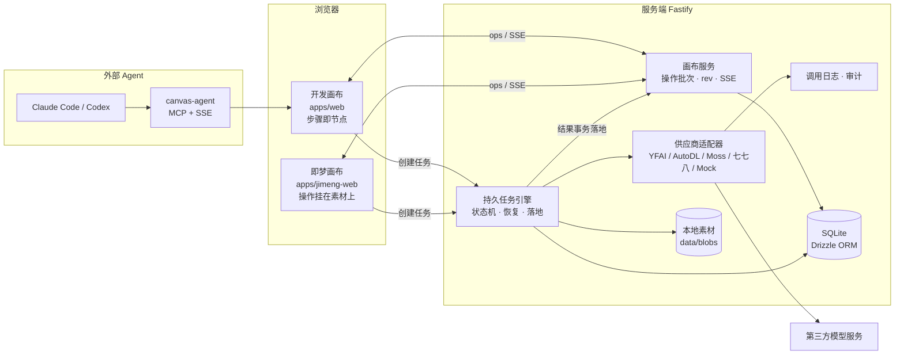

<div align="center">


# FrameDock · 帧坞

**面向 AI 影像创作者的自部署无限画布与节点式工作流平台**

从一句想法到一条成片：剧本、分镜、角色设定、图片与视频生成，在同一张画布上完成、复用和追溯。


[项目背景](#-项目背景为什么要做-framedock) · [核心能力](#-核心能力) · [系统架构](#-系统架构) · [关键技术设计](#-关键技术设计) · [工程实践](#-工程实践) · [快速开始](#-快速开始)

</div>

---

## 📌 一句话介绍

FrameDock 把 AI 短片创作中「剧本 → 分镜 → 角色/场景设定 → 出图 → 出视频」这条原本散落在多个网站、多个账号、多份笔记里的流程，收拢成一张**可编排、可复用、可追溯、花费可控**的无限画布。画布上的连线就是真实的数据依赖，结果由服务端可靠落地，AI Agent 可以在用户确认下直接读写画布。

## 🎯 项目背景：为什么要做 FrameDock

AIGC 让个人创作者也能做短片，但真正做过一条完整短片的人都会遇到下面这些问题。FrameDock 的每一项核心设计都对应其中一个痛点，表中数据来自项目实际运行中遇到的真实事故。

| # | 痛点 | 真实表现 | FrameDock 的解法 |
|---|---|---|---|
| 1 | **工具链割裂，流程无法沉淀** | 剧本在对话模型里写，分镜在 MJ / 即梦里出，视频在可灵 / Seedance 里生成，素材靠下载再上传搬运；做完一条片子，流程本身没有留下任何可复用的东西 | 无限画布 + 节点式工作流：连线即数据依赖，支持「运行到此处 / 运行下游」，一条链路保存成模板即可复用 |
| 2 | **多镜头一致性差** | 8 个分镜并发渲染，同一角色在第 5、6 镜是两张脸，渡船形制、栈桥走向每张都不一样 | 多镜头卡片「首镜母版」调度：首镜先出并自动设为母版，其余镜头带母版参考并发渲染；项目级风格库锁定画风 |
| 3 | **付了钱却拿不到结果** | 异步生成任务的 task id 只存在于页面闭包里，刷新、热更新、休眠即丢失；供应商控制台 25 笔扣费，本地 0 笔能对上 | 服务端持久化任务引擎：先落盘再提交、幂等重提、重启恢复轮询、未送达追踪和对账审计 |
| 4 | **多窗口互相覆盖数据** | 画布整份 JSON「后写者赢」，旧标签页一次视口保存就覆盖了另一个标签页的结果，一次丢失 6 张已付费图片 | 画布数据归服务端：按「操作批次」事务写入、字段级合并、单调版本号、SSE 增量同步、软删除墓碑 |
| 5 | **花费不透明** | 同一个 Seedance 模型，不锁渠道时单次估价在 ¥1.47–¥15.02 之间浮动；某些默认参数悄悄把单价翻倍 | 选模型时即显示价格，多镜头渲染前显示总价，特价渠道价格护栏，所有供应商调用全量记日志 |
| 6 | **每家模型的“方言”都不一样** | 参考图在提示词里怎么引用（图1 / @image1 / 占位符）、比例和分辨率参数名、上限，每个模型都不同 | 统一的参考图芯片 `@[node:id]`，按发送顺序编号并翻译成各模型语法；模型能力声明驱动参数表单 |
| 7 | **好提示词难以复用** | 优质的分镜、三视图、服装道具提示词散落在笔记和网页里，每次手抄、手改 | 官方预制节点与 Skill：把成熟提示词库（MOKE AIGC）的分类、模板和层级封装成开箱即用的节点 |
| 8 | **“可调试”与“好上手”难以兼得** | ComfyUI 式节点图对工程师友好，对创作者门槛高；即梦式画布易用，但处理过程是黑盒，无法调参 | 双画布架构：开发画布把每一步摊开用于研究和调参，即梦画布把能力收进素材工具栏服务创作 |
| 9 | **AI Agent 改画布不可控** | 外部 Agent 只能查库、在页面里注入代码、模拟点击，曾误拖动节点 | 画布 MCP 通道 + 提案式写入：Agent 读画布、提出改动，用户确认后整批应用，可一键撤销 |

## ✨ 核心能力

### 画布与工作流

- **无限画布**：文本、图片、视频、音频、分组节点；吸附对齐、框选、小地图、撤销/重做，裁剪、蒙版、分割、放大等图片工具。
- **连线即数据流**：上游输出自动成为下游输入；支持单节点运行、运行到此处、运行下游，失败阻断下游，上游变化后下游标记为过期。
- **生成历史**：每个节点保留历次生成结果，可切换和回溯。
- **一键工作流模板**：短片分镜链、角色一致性链、角色三视图等。

### 面向影视创作的专业节点

- **多镜头分镜卡**：剧本拆镜、逐镜提示词、首镜母版、单镜重渲染、尾帧续接、转场镜头。
- **美术资产节点**：角色定稿、三视图与面部特写、服装、道具、分镜包，母版在节点间共享。
- **镜头预演**：运镜、动态分镜、循环动作、动作戏导演等 Skill 节点。
- **风格库**：风格卡（描述词、负面词、参考图、推荐模型），项目级锁定，节点级覆盖，风格变化后结果自动标记过期。
- **风格复刻**：多轮拟合参考图的画风或画面。
- **一键调色**：将结果对齐到母版图的色调。

### 模型与成本

- **一个 Key 用全部模型**：接入 YFAI、AutoDL、Moss、七七八等聚合渠道，覆盖对话、图片（GPT-Image-2、Nano Banana、Qwen-Image 等）、视频（Seedance、可灵、海螺、万相等）与音频；同时支持自定义 OpenAI 兼容渠道。
- **价格前置**：模型选择器内显示单价，多镜头渲染前显示总价，账户余额与扣费流水可查。
- **本地模拟渠道**：不花钱即可端到端跑通整条链路，所有自动化测试都基于它。
- **调用日志**：每一次供应商调用都带上下文记录，可从日志跳回对应节点。

### AI Agent

- **画布 MCP 服务**：Claude Code、Codex 等外部 Agent 通过 MCP 查询节点、批量修改画布、重渲染指定镜头。
- **画布内 AI 对话**（即梦画布）：流式回答、多步工具调用循环、改动以提案卡片呈现，确认后整批应用并可一步撤销；AI 新建的节点按关系自动排版。

## 🏗 系统架构



设计原则：**服务端是画布的唯一真相，页面只是视图和编辑器。** 生成任务从提交、轮询到把结果写进目标节点全部在服务端完成；没有页面开着，结果也不会丢。

## 🔬 关键技术设计

### 1. 持久任务引擎：杜绝「已扣费却没出图」

AI 图片/视频生成是异步任务，从几十秒到几十分钟不等，期间页面刷新、服务重启、网络抖动都是常态。

- **先落盘，再提交**：任务以状态机（`pending → submitted → running → succeeded / failed`）持久化在 SQLite，拿到供应商 task id 立即写库。
- **幂等重提**：使用供应商的 `client_request_id` 防重复机制，提交超时不盲目重发，避免重复扣费。
- **重启恢复**：服务启动时扫描未完成任务，凭 task id 继续轮询；对 502/504、429、网络错误做分级容忍。
- **服务端落地**：任务成功后在同一个画布事务中把结果写入目标节点（明确的 `targetNodeId` + 图片槽位 id），再经 SSE 推送；页面不再负责落结果。
- **可对账**：记录 task id 与 `X-Request-Id`，提供未送达追踪、任务审计和 `verify:yfai` 校验脚本，本地记录与供应商控制台一一对应。

### 2. 服务端画布：以操作为单位的增量同步

为解决「整份 JSON 后写者赢」造成的数据覆盖：

- 画布拆分为 `canvas_projects`、`canvas_nodes`、`canvas_connections` 三张表，节点保留前端原有数据形状，前端类型零改动。
- 页面把本地改动转换为**操作批次**（新增/修改/删除节点与连线），服务端在 SQLite `IMMEDIATE` 事务中整批应用，任一操作无效则整批回滚。
- 修改节点只带变更字段，`metadata` 按键浅合并，`null` 表示删除键；**没有整份覆盖**，冲突按字段级后写者赢处理。
- 项目维护单调递增的 `rev`，每行记录最后修改的 `rev`，删除保留墓碑；SSE 推送每次提交，断线后按 `changes?since=rev` 补齐。

### 3. 多镜头一致性：首镜母版调度

- 「渲染全部」先只渲染第 1 镜，成功后自动设为母版，其余镜头带母版参考图按并发上限渲染；首镜失败则不继续，避免批量浪费。
- 用户手动指定的母版优先，不会被自动覆盖；关闭开关可回到全并发模式做 A/B 对照。
- 母版与风格参考图计入模型参考图数量上限，放不下时减少风格图并提示，而不是让请求失败。
- 修改多镜头提示词时同步剧本段落、镜头数据与镜头节点三处，保证单一事实来源。

### 4. 参考图引用与模型适配

- 提示词中以芯片 `@[node:id]` 引用连入的图片，发送时按实际发送顺序编号，并翻译为各模型的引用语法。
- 模型能力声明（支持的操作、参考图/视频数量、比例、分辨率、时长、提示词上限）驱动参数表单生成和服务端校验；像素尺寸统一映射到 `aspect_ratio`。
- 供应商以适配器形式接入，统一 `submit / poll / estimateCost` 接口，新增渠道无需改动画布层。

### 5. Agent 与画布协作

- **MCP 通道**：本地 canvas-agent 同时提供 MCP（stdio）与 HTTP + SSE，把外部 Agent 的工具调用转发给已打开的画布执行，写操作需用户在面板中确认。
- **提案式写入**：画布内 AI 对话中，模型通过工具读取画布、提出改动，改动以确认卡片呈现，确认后在一次同步调用中整批应用，对应撤销栈中的一步。
- **可回放测试**：本地模拟模型内置确定性的工具调用剧本，无需真实模型即可测试完整的 Agent 循环。

### 6. 双画布架构

| | 开发画布 | 即梦画布 |
|---|---|---|
| 定位 | 研究与调参：每个处理步骤都是一个节点，输入、参数、输出全部摊开 | 面向创作：素材是主体，操作挂在选中素材的工具栏和生成面板上，结果直接成为新节点 |
| 前端 / 后端 | `apps/web` / `apps/server` | `apps/jimeng-web` / `apps/jimeng-server` |
| 数据 | `data/` | `data-jimeng/` |

两套画布的代码、端口、后端、数据目录和环境变量完全隔离，一边故障不影响另一边。开发画布上验证过的预设、提示词和 Skill 再反哺到即梦画布。

### 7. 画布性能

- 定位拖动卡顿根因：每帧变化的属性被传给了所有节点；改为语义节点列表，只让真正变化的节点重渲染。
- 平移、缩放时去掉每帧的 React 重渲染；低缩放级别启用 LOD，视频节点显示 poster，图片按需加载、节点使用缩略图。
- 画布崩溃时自动重新挂载，并记录出错组件链路。

## 🛠 工程实践

- **任务卡驱动的人机协作**：所有实现以任务卡（`docs/tasks/`，近百张）分派，卡片写明背景、范围、白名单文件、验收标准和完成报告，由 Claude 设计与验收、Codex 等 Agent 执行，每张卡验收通过后才提交。
- **真实运行复盘**：以一条完整短片（「晨雾渡口」）做端到端验证，产出运行留痕、费用账本和整改清单，再转化为任务卡（多镜头母版、价格护栏、视频风格注入等）。
- **零成本测试**：本地模拟渠道覆盖文本、图片、视频与 Agent 工具调用，服务端核心模块（画布存储、任务引擎、结果落地、供应商适配器、审计）均有单元测试。
- **复用优先**：前端基于开源项目 [infinite-canvas](https://github.com/basketikun/infinite-canvas)（MIT）二次开发，即梦画布界面引入 beUI 组件库；所有第三方代码保留版权声明并登记在 `THIRD_PARTY_NOTICES.md`。
- **工程规范**：pnpm workspace monorepo，前后端共享 zod schema，Biome 统一 lint 与格式化，Drizzle 管理数据库迁移。

## 🧰 技术栈

| 层 | 选型 |
|---|---|
| 前端 | React 19 · TypeScript · Vite 7 · antd 6 · Tailwind CSS v4 · Zustand · React Flow（即梦画布） |
| 后端 | Node.js 22 · Fastify 5 · SQLite（better-sqlite3）· Drizzle ORM · SSE |
| 共享 | zod schema（`packages/shared`） |
| Agent | Model Context Protocol · OpenAI 兼容工具调用（流式） |
| 工程 | pnpm workspace · Biome · node:test / bun test · launchd 部署（Docker 镜像规划中） |

## 🚀 快速开始

环境要求：Node.js 22.18+，pnpm 11。

```bash
pnpm install
pnpm dev          # 开发画布  http://localhost:5100（后端 8787）
pnpm dev:jimeng   # 即梦画布  http://localhost:5200（后端 8797）
pnpm dev:all      # 全部启动
```

首次使用可在设置中选择「本地模拟」渠道，无需任何 API Key 即可体验完整工作流；接入真实模型时在设置页填写对应渠道的 Key。部署与备份说明见 `docs/deploy.md`。

## 📁 目录结构

```text
FrameDock/
├── apps/
│   ├── web/              # 开发画布前端
│   ├── server/           # 开发画布后端：画布服务、任务引擎、适配器、日志
│   ├── canvas-agent/     # 本地 Agent 桥：MCP + HTTP/SSE
│   ├── jimeng-web/       # 即梦画布前端
│   ├── jimeng-server/    # 即梦画布后端（数据独立）
│   └── canvas-ui-lab-v2/ # 即梦画布交互复刻研究（只读参考）
├── packages/shared/      # 前后端共享的 zod schema 与类型
├── docs/
│   ├── design.md         # 权威设计文档
│   ├── design/           # 专题设计与手册
│   ├── tasks/            # 任务卡与验收记录
│   └── runs/             # 端到端运行留痕与复盘
└── scripts/              # 启动、校验与运维脚本
```

## 🗺 路线图

- [x] 无限画布与节点式工作流、运行到此处 / 运行下游
- [x] 持久任务引擎、服务端结果落地、调用日志与对账
- [x] 服务端画布存储与 SSE 增量同步
- [x] 多镜头分镜、首镜母版、风格库、美术资产与镜头预演节点
- [x] 画布 MCP 通道、即梦画布 AI 对话与提案式改画布
- [ ] 即梦画布全部节点类型适配、首页按创作场景重做
- [ ] 开发画布研究成果反哺即梦画布
- [ ] 镜头调度一致性（机位、构图跨镜头保持）
- [ ] 输入哈希缓存：未变化的节点不重复生成

## 🙏 致谢

- [infinite-canvas](https://github.com/basketikun/infinite-canvas)（MIT）：开发画布前端与 canvas-agent 的基础。
- [MOKE AIGC 提示词库](https://www.mokeaigc.ai/cinematique.html)：预制节点与 Skill 的提示词方案来源。
- beUI、LobeHub Icons、Geist、霞鹜文楷等开源项目，完整清单见 `THIRD_PARTY_NOTICES.md`。
- Logo 暂借用即梦（Dreamina）的图标作为占位，版权归原所有者。
