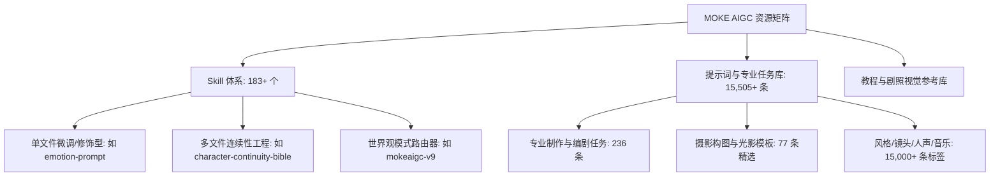
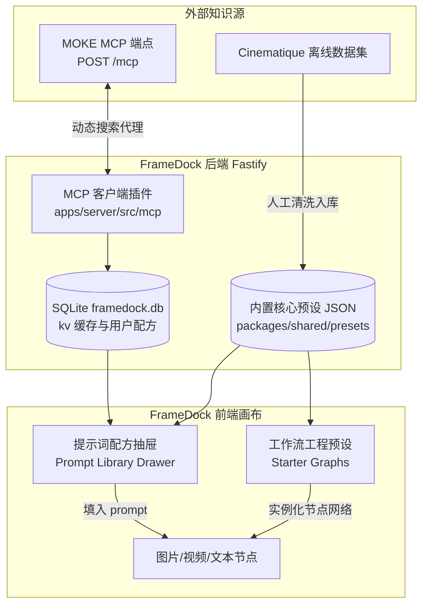

# MOKE AIGC 深度调研与 FrameDock 提示词与 Skill 接入完整方案报告

- **调研对象**：[MOKE AIGC 官网](https://www.mokeaigc.ai/)
- **核心模块**：[MCP 协议](https://www.mokeaigc.ai/mcp.html)、[Cinematique 提示词库](https://www.mokeaigc.ai/cinematique.html)、[Skill 市场](https://www.mokeaigc.ai/skill.html)
- **调研基准日期**：2026-10-17
- **适用项目**：FrameDock（帧坞）自部署无限画布与节点工作流系统

---

## 目录

1. [调研概况与一手数据源](#一-调研概况与一手数据源)
2. [MOKE 平台架构与核心资产解构](#二-moke-平台架构与核心资产解构)
   - 2.1 [Skill 体系深度剖析（183+ 个）](#21-skill-体系深度剖析)
   - 2.2 [Cinematique 专业提示词库剖析（15,505+ 条）](#22-cinematique-专业提示词库剖析)
   - 2.3 [摄影构图 22 核心模板库（详尽定义）](#23-摄影构图-22-核心模板库)
   - 2.4 [光影色彩与专业制作任务（10 项方案）](#24-光影色彩与专业制作任务)
   - 2.5 [长视频动作表演与防畸变运动描述（12 种规律）](#25-长视频动作表演与防畸变运动描述)
3. [MOKE 协议接口与接入通道评估](#三-moke-协议接口与接入通道评估)
   - 3.1 [官方 MCP JSON-RPC 2.0 端点实测](#31-官方-mcp-json-rpc-20-端点实测)
   - 3.2 [Web REST API 与数据模型](#32-web-rest-api-与数据模型)
4. [安全审查、版权与风险边界](#四-安全审查版权与风险边界)
5. [FrameDock 接入架构设计](#五-framedock-接入架构设计)
   - 5.1 [前端形态：节点提示词配方抽屉（Prompt Drawer）](#51-前端形态节点提示词配方抽屉prompt-drawer)
   - 5.2 [前端形态：开箱即用画布工作流模板（Starter Graphs）](#52-前端形态开箱即用画布工作流模板starter-graphs)
   - 5.3 [后端与存储层设计（SQLite + Local Presets + MCP Client）](#53-后端与存储层设计)
6. [落地路线图与任务卡规划（T006 - T008）](#六-落地路线图与任务卡规划)

---

## 一、 调研概况与一手数据源

本次调研对 MOKE 平台的生产环境进行了抓包实测、协议逆向与离线数据解码分析，覆盖以下一手事实源：

| 来源编号 | 目标端点 / 资源 | 协议与性质 | 实测核心发现 |
| :--- | :--- | :--- | :--- |
| **S01** | `POST https://www.mokeaigc.ai/mcp` | MCP JSON-RPC 2.0 | 协议版本 `2025-03-26`，支持匿名读取，公开声明 5 个工具 |
| **S02** | `GET /api/skills?publicPage=skills` | Skill 目录 REST API | 公开可检索条目 183 条，包含多维分类、下载指标与安全扫描评级 |
| **S03** | `GET /api/skills/{ns}/{slug}` | Skill 详情与文件 API | 包含 `manifest_json`、文件哈希清单（SHA-256）及版本变更历史 |
| **S04** | Cinematique 提示词核心离线包 | 7 份数据集解码 | 累计解码 **15,505 条** 结构化提示词与影视专业任务记录 |
| **S05** | `https://www.mokeaigc.ai/terms.html` | 服务条款与隐私政策 | 规定依各 Skill 独立许可证使用，平台不预设自由商用再分发权 |

---

## 二、 MOKE 平台架构与核心资产解构

MOKE 的本质是**将影视工业流程（编剧、摄影、灯光、表演连续性）结构化为 AI 可消费的任务约束与提示词工程**。



### 2.1 Skill 体系深度剖析

MOKE 的 Skill 遵循标准 Agent Markdown 规范（含 YAML frontmatter），分发通过 CLI `npx @astron-team/skillhub@latest` 按 `namespace/slug` 安装。

#### 代表性 Skill 案例分析：

1. **`emotion-prompt`（情绪表情控制）**：
   * **层级模型**：采用三层递进表达：`情绪分类` $\rightarrow$ `面部解剖微动作` $\rightarrow$ `躯干姿态与呼吸配合`。
   * **价值**：将“绝望”翻译为“眉心紧锁上抬、下唇内抿、胸廓起伏骤减并伴随停顿”，可直接注入 FrameDock 的角色特写生成节点。
2. **`character-continuity-bible`（角色连续性圣经）**：
   * **结构**：由 4 个文件组成，定义了跨镜头的实体状态机。
   * **价值**：显式区分**绝对不变约束**（五官骨相、特征伤疤、标志配色）与**允许变化维度**（光影投射、景别缩放、衣物污损），解决工作流整条链执行时角色变脸的痛点。
3. **`mokeaigc-v9`（多模式导演）**：
   * **结构**：内置规则路由器，按模式划分为“世界展开 / 生物设计 / 构图探索”。
   * **价值**：定义严格的输出边界，明确静帧生成时不夹带动态运镜参数，避免模型产生语义混淆。

---

### 2.2 Cinematique 专业提示词库剖析

解码得到的 15,505 条记录中，高价值部分主要分布在以下领域：

#### 编剧任务（29 条）：把一句话灵感转化为可拍摄的因果链
* **体量形式**：概念超短片（1~3 分钟）、叙事短片、连续剧、竖屏短剧等；
* **题材因果法则**：11 类核心题材（现实、悬疑、科幻、犯罪等），要求“信息差、代价与后果”真实发生，而非仅靠氛围词；
* **11 步精简制作链**：
  $$\text{破题 (ideas)} \rightarrow \text{梗概 (synopsis)} \rightarrow \text{场景拆解 (scenes)} \rightarrow \text{单场草稿 (draft)} \rightarrow \text{剧本诊断 (diagnosis)}$$

---

### 2.3 摄影构图 22 核心模板库

MOKE 提炼的构图不是虚泛的风格词，而是具体的空间几何与视点关系，极适合作为节点预设：

| 编号与 ID | 构图名称 | 真正控制的核心画面关系 | 必需补充的变量 | 适用场景 |
| :--- | :--- | :--- | :--- | :--- |
| `06` | **贴地平视** | 地面前景延伸、中景主体、极低水平视角 | 地面材质、前景物、主体、光向 | 雨街反光、奔跑脚步、车轮特写、巨物仰视 |
| `10` | **侧面轮廓** | 鼻唇下颌连续轮廓与视线留白，排除正面双眼 | 身份特征、背景对比度、边缘轮廓光 | 人物沉思、内心独白、剪影海报 |
| `14` | **物体内部视角** | 容器开口形成天然画框，主体伸手探入 | 容器材质、拿取物、外部环境光 | 开冰箱、翻抽屉、开保险箱、窥探手提箱 |
| `15` | **遮挡窥视** | 暗且略虚的前景遮挡，限定中远景观察视窗 | 遮挡物（百叶窗/门缝/树叶）、被观察者 | 悬疑追击、秘密监视、偷窥感叙事 |
| `16` | **群像定格式布局** | 多人物空间散布、差异化视线方向与共同道具 | 人数、各自站位、视线焦点、中心道具 | 战术会议、家庭晚餐、群像戏剧张力 |
| `17` | **超广角近远对比** | 极近前景夸张放大，背景强烈纵深透视 | 前景极近物、消失点方向、主体居中 | 迎面冲刺、巨物压迫感、冲击力视觉 |
| `18` | **鱼眼曲线** | 边缘强烈桶形畸变与中心主体凸起 | 场景边线、中心对象、道具距离 | 精神致幻、门镜视点、极端动作运动相机 |
| `20` | **近远双区域清晰** | 前景极近与后景极远两处均清晰（双焦移轴） | 近端线索物、远端人物反应、遮挡过渡 | 悬疑片经典镜头（前景毒药/后景凶手） |
| `21` | **移轴微缩观感** | 俯视角度下的窄带水平清晰区，两侧渐变虚化 | 俯视空间、焦点带位置、微小人车 | 城市全景、模型感表现、全知上帝视点 |
| `22` | **微距材质** | 毫米级表面微观纹理与侧向掠射光 | 材质表面、微结构、微尘或液滴 | 皮肤纹理、织物纤维、机械零件、水珠细节 |
| `23` | **长焦空间压缩** | 远距拍摄造成的景深极浅与前后景叠压感 | 主体、紧贴背景层、边缘光照 | 街道拥挤人群、烈日热浪变形、狙击视点 |
| `27` | **局部追光/聚光** | 大面积暗场中的窄光束打亮特定动作或物品 | 受光物、光束边界、周围暗环境 | 审讯室、舞台独白、暗室线索发现 |
| `28` | **薄雾光束** | 空间颗粒形成的丁达尔光束（God Rays） | 窗户/孔隙位置、光源方向、空气烟雾 | 清晨森林、废弃教堂、阳光射入仓库 |
| `29` | **胶片高光光晕** | 强点光源边缘形成的暖红色扩散光晕（Halation） | 画面内点光源、夜景霓虹、逆光轮廓 | 胶片复古质感、王家卫风格都市夜景 |
| `33` | **低饱和有限色盘** | 大面积中性灰调配合极小面积的高饱和强调色 | 整体基调色、单一点缀色及其实体物 | 强调关键线索、压抑冷峻氛围、概念艺术 |
| `34` | **互补色分区** | 近景暖光与远景冷光（或相反）由光源支持分区 | 冷暖各自光源位置、交界处阴影过渡 | 赛博朋克夜市、炉火与月夜并存室内 |
| `37` | **高密度陈设秩序** | 极多物件通过层次穿插、重复元素维持主次 | 前中后景陈列物、视觉引导线 | 侦探办公室、老药铺、手工作坊、生活痕迹 |
| `38` | **镜面/水面反射** | 主体与倒影对称对应，共享光源与波纹变形 | 反射介质（积水/立镜）、虚实对应点 | 双重人格隐喻、雨夜倒影、自省时刻 |
| `40` | **连续运动模糊** | 静止参照系保持清晰，运动部位呈线性拖尾 | 运动方向、静止部位、快门速度感 | 疾驰列车、出拳瞬间、快速回头 |
| `41` | **双重曝光** | 主体外轮廓内填充第二层场景或材质景象 | 主剪影角色、内嵌风景图、过渡灰阶 | 意识流回忆、心理状态外化、片头设计 |
| `43` | **离散残影** | 沿运动轨迹留下 2~3 个半透明淡化动作快照 | 轨迹线、分阶段姿态、最终停留实体 | 超能力瞬移、舞蹈轨迹、时间停滞感 |
| `48` | **分屏摄影叙事** | 画面均分多格，通过动作或视线建立跨屏呼应 | 各屏独立事件、共同色彩线索、分界线 | 电话两端通话、并行动作对比、线索拼接 |

---

### 2.4 光影色彩与专业制作任务

| 模板 ID / 名称 | 核心输入要素 | 控制法则与交付物 |
| :--- | :--- | :--- |
| `foundation-lighting-size-distance` 光源尺寸与距离实验 | 发光面面积、距主体距离、环境反射率 | 硬光与软光、明暗衰减分开；输出软硬过渡方案 |
| `foundation-lighting-ratio` 光比与曝光策略 | 关键面部明暗差、背景照度、测光口径 | 确定主光与辅光档位差（如 4:1、8:1）；写出暗部保留细节 |
| `foundation-lighting-bounce` 反射与负补光设计 | 墙面材质、反光板位置、吸光黑布摆位 | 消除无来源杂光，让阴影面沉淀干净自然的暗调 |
| `foundation-lighting-motivated` 动机光与可见灯具协调 | 窗向、可见台灯/路灯、走位路径 | 每个光源均有画面内的物理根据，角色移动时曝光平滑连续 |
| `foundation-lighting-viewpoint` 焦距与机位视点分离 | 机位距离变化 vs 镜头焦段切换 | 区分真实空间透视与画面缩放，避免“改焦距以为改了透视” |
| `foundation-color-shot-match` 镜头间色彩匹配 | 连续分镜头、基准色彩卡、监看环境 | 区分故意为之的场景色调变化与白平衡失真 |
| `foundation-photography-product` 产品材质微距拍摄 | 产品形体、倒角高光、微观纹理 | 突出标识、缝线、光泽与材质质感 |
| `foundation-photography-architecture` 建筑透视方案 | 视平线高度、垂直线校正、广角覆盖率 | 保持垂直线条绝对垂直，杜绝广角产生劣质桶形畸变 |
| `foundation-photography-documentary` 纪实关系捕捉 | 现场光线、真实人际互动、不可干预边界 | 拒绝棚拍打光感，保留现场环境氛围与抓拍质感 |
| `foundation-color-lut-gamut` 色彩工作流 | 转换空间、调色风格倾向、高光压制 | 创意外观（Look）与空间转换区分，保留皮肤中间调 |

---

### 2.5 长视频动作表演与防畸变运动描述

在视频生成中，直接写“一个人在跑”极易引发模型肢体畸变。MOKE 沉淀的核心表演法则：
1. **搬运力学（Performance-Lift）**：必须先写明手指抓握点与物体重量感，紧接着描述腿部下沉、背部发力，最后才是离地过程；
2. **次级运动衰减（Follow-Through）**：主体躯干停止运动后，衣摆、长发应在接下来的 2~3 帧内产生阻尼减速并自然下垂；
3. **双人接触时序（Partner Interaction）**：递物、握手时，发起方伸手到位、接收方产生视线确认并伸手接触，严禁双方在同一时间凭空粘连；
4. **起跑预备动作（Anticipation）**：冲刺前重心先反向微沉、手臂后摆，杜绝直接以匀速滑行动作开场；
5. **视线引导转头（Eye-Lead Turn）**：头部旋转时眼神先于面部转向目标，接着颈部带动肩膀转动；
6. **脚步接地权重（Foot Planting）**：脚掌触地时必须有明确的受力接触面与重心转移，杜绝“太空步”滑行。

---

## 三、 MOKE 协议接口与接入通道评估

### 3.1 官方 MCP JSON-RPC 2.0 端点实测

端点地址：`POST https://www.mokeaigc.ai/mcp`
* **初始化握手实测**：
  ```json
  // Request
  {
    "jsonrpc": "2.0",
    "id": 1,
    "method": "initialize",
    "params": {
      "protocolVersion": "2025-03-26",
      "capabilities": {},
      "clientInfo": { "name": "FrameDock-Client", "version": "0.1" }
    }
  }

  // Response (HTTP 200 OK)
  {
    "jsonrpc": "2.0",
    "id": 1,
    "result": {
      "protocolVersion": "2025-03-26",
      "serverInfo": { "name": "moke-materials", "version": "1.0.0" },
      "capabilities": { "tools": { "listChanged": true } }
    }
  }
  ```

* **5 大工具完整契约**：

```text
1. search_materials
   - 输入：query (string), type ("all"|"skill"|"prompt"), category (string), limit (1-50), cursor (string)
   - 行为：返回材料摘要与稳定 ID，不返回大正文；用于快速检索。

2. get_material
   - 输入：id (string), version (string, 可选), language ("zh"|"en")
   - 行为：返回详细元数据、作者、多文件目录树及 SHA-256 签名。

3. read_skill_file
   - 输入：id (string), version (string), path (string), language ("zh"|"en")
   - 行为：读取文件文本（限制 UTF-8，上限 256KiB），严格禁止路径穿越。

4. render_prompt
   - 输入：id (string), version (string), parameters (object, 如 { "Subject": "女孩" })
   - 行为：执行参数化模板插值，返回渲染后的提示词；不调用模型。

5. get_skill_install_info
   - 输入：id (string), version (string)
   - 行为：返回源码压缩包直链及文件哈希清单，用于下载校验。
```

---

## 四、 安全审查、版权与风险边界

在引入 FrameDock 时必须严守以下底线：

1. **版权与许可合规**：
   * MOKE 绝大多数 Skill 在其 manifest 中未声明标准开源协议（显示为 `MANIFEST_MISSING_LICENSE`）。
   * **策略**：FrameDock **不打包复制其私有代码包**；而是将行业通用的电影摄影、编剧方法学吸收重构成原生 Preset；对远程资源通过用户主动发起的 MCP 请求实时检索引用。
2. **拒绝外部代码执行**：
   * 部分 Skill（如 `director-seedance-prompt`）被静态扫描出包含 `BEHAVIOR_EVAL_SUBPROCESS`（包含运行本地 Python 进程）。
   * **策略**：FrameDock **绝不执行任何远程脚本**，所有输入只作为纯文本模版（Markdown/JSON）消费。
3. **消除虚假参数污染**：
   * 剔除“ARRI ALEXA 35 宽动态”、“85mm f/1.8 景深”等普通文生图模型无法解析的营销词，转化为“柔和侧面轮廓光”、“背景平滑虚化”等明确视觉特征。

---

## 五、 FrameDock 接入架构设计

结合 FrameDock 的无限画布架构，整体接入方案分为三层：



### 5.1 前端形态：节点提示词配方抽屉（Prompt Drawer）

在画布中选中图片、视频或文本节点时，在其悬浮编辑条或右侧属性栏提供「✨ 配方」入口：
* **多维选择**：
  * **构图（22 式）**：贴地平视、门缝窥视、近远双清晰、移轴微缩等；
  * **光影（10 式）**：窗户自然光、薄雾丁达尔光束、互补色分区等；
  * **动作表演（12 式）**：抓握发力起步、次级运动衰减、递物时序；
  * **情绪微表情**：按 `emotion-prompt` 注入微表情层与动作层。
* **参数化插值**：
  * 面板提供 `[Subject]` 输入框，用户输入“红衣女刺客”，一键生成结构化提示词并回填至节点输入框。

### 5.2 前端形态：开箱即用画布工作流模板（Starter Graphs）

将 MOKE 的编剧与分镜方法固化为 FrameDock 的预设工程：

```text
[文本节点: 故事灵感]
  │
  └──> [文本节点: 场景拆解表 (Scenes)]  <-- 搭载 screenwriting-scenes 任务规范
         ├──> [生图节点: 场景建立全景]  <-- 搭载 photography-template-17 (超广角纵深)
         ├──> [生图节点: 角色关系中景]  <-- 搭载 photography-template-20 (近远双清晰)
         └──> [生视频节点: 动作推进]   <-- 搭载 creative-animation (抓握发力与次级运动)
```

### 5.3 后端与存储层设计

1. **本地静态核心预设（内置无网可用）**：
   * 将清洗后的 22 类构图、10 种光影及 12 类表演动作用标准 JSON 文件固化至 `packages/shared/src/presets/`。
2. **服务端 MCP 客户端支持（可选动态扩展）**：
   * 在 `apps/server/src/mcp/` 中实现一个标准 JSON-RPC 客户端，用户可在设置中开启“在线 MOKE 知识源”；
   * 提供接口 `GET /api/mcp/search?query=...`，请求先查本地 SQLite 缓存，未命中时向 MOKE MCP 端点发起请求并落库。

---

## 六、 落地路线图与任务卡规划

按 FrameDock 的任务卡协作规范（写入 `docs/tasks/`），分三阶段演进：

### 阶段一：高频核心预设本地化（推荐优先实施）
* **任务卡**：`docs/tasks/T006-preset-prompt-library.md`
* **目标**：
  1. 在 `packages/shared/src/presets/` 落地静态数据；
  2. 在前端节点悬浮工具条增加「提示词配方抽屉」组件，支持分类筛选与 `[Subject]` 变量替换。
* **验收标准**：无需外网，点击生图/生视频节点即可在 3 秒内挑选并组装好专业机位提示词。

### 阶段二：典型创作工作流模版（Starter Projects）
* **任务卡**：`docs/tasks/T007-canvas-workflow-templates.md`
* **目标**：
  1. 新增画布模版加载机制；
  2. 预置“短片分镜创作链”、“角色一致性生成链”两套模板。
* **验收标准**：新建项目可一键生成全套节点网络与连线，配合 Mock 或真实 API 直接端到端运行。

### 阶段三：服务端 MCP 动态检索客户端（可选扩展）
* **任务卡**：`docs/tasks/T008-moke-mcp-integration.md`
* **目标**：
  1. `apps/server` 接入 MOKE 官方 MCP 协议端点；
  2. 提供只读检索与安全过滤代理，前端支持搜索远程 183+ Skill 知识库。
* **验收标准**：在前端能检索并引用 MOKE 远程提示词，数据自动缓存入本地 SQLite。

---

## 七、落地情况（2026-10-17，补充）

上文第五、六节的方案已落地一版，与原规划的差异如下：

- **实测接口**：MOKE MCP 必须带 `Accept: application/json, text/event-stream`。Skill 的 `search_materials`、`get_material`、`read_skill_file` 都能匿名调用；**提示词库需要 OAuth 登录**（scope `prompt:read`，认证服务器 `oss.mokeaigc.ai`），这一版没有接入。
- **服务端**：`apps/server/src/moke.ts`（`/api/moke/skills`、`/api/moke/skill`、`/api/moke/skill/file`）。
  - 缓存：搜索在内存里缓存 10 分钟；详情和文件写入 `kv` 表的 `moke_cache`，缓存 7 天。没有另建表。
  - 只允许读取文本文件，不执行任何内容。
  - 环境变量 `FRAMEDOCK_MOKE=0` 可以关闭。
- **内置配方**：放在 `apps/web/src/lib/presets/prompt-presets.ts`（没有放 `packages/shared`，因为 web 端不引用 shared）。包括构图 22、光影 10、动作表演 6、情绪 6，全部用自己的话重写，只描述画面。
- **Skill**：
  - 数据和逻辑在 `apps/web/src/lib/skills/skills.ts`，界面在 `components/skills/skill-browser.tsx` 和 `components/canvas/canvas-skill-picker.tsx`。
  - Skill 挂在文本节点上，或者文本模式的生成配置节点上。挂上时把说明保存成快照，生成时作为 system prompt 注入。
  - 另外附带 4 个 FrameDock 自写的内置 Skill。
- **模板**：`apps/web/src/lib/canvas/canvas-templates.ts`，包括“短片分镜链”和“角色一致性链”。工作流运行时文本节点不算步骤，所以 Skill 放在文本模式的生成配置节点上。
